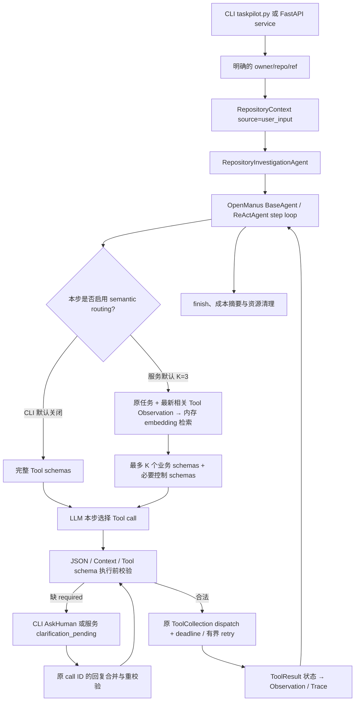

# TaskPilot 当前架构（Core，只读）

本文对应已交付的只读 Core MVP 源码。运行命令见 [README](../README.md) 和 [使用指南](USAGE.md)；真实调用证据、正式评测及限制见 [公开文档索引](INDEX.md) 与 [Benchmark](BENCHMARK.md)。

## 调用边界

入口代码是 [`taskpilot.py`](../taskpilot.py) 和 [`app/taskpilot/service.py`](../app/taskpilot/service.py)。两者均构造 [`RepositoryInvestigationAgent`](../app/agent/repository_investigation.py)，复用 OpenManus [`BaseAgent.run`](../app/agent/base.py)、[`ReActAgent`](../app/agent/react.py) 和 [`ToolCallAgent`](../app/agent/toolcall.py)；没有将任务类型写成固定的工具序列。专用工具池由五个 [`GitHubReadOnlyTool`](../app/taskpilot/github_tools.py) 和 `terminate` 组成。GitHub Adapter 只发 REST `GET`，其仓库、Issue、Code Search 和文件结果被裁剪为调查所需字段。

### 任务与工具身份

- `RepositoryContext.parse` 要求 `owner/repo` 的明确 `user_input` 来源；可选 `ref` 随任务传入。已有可信 `owner/repo/ref` 只在该任务的参数补全中复用，模型推测或 schema default 不成为可信来源。显式冲突阻止原工具执行。
- `BaseTool.metadata` 是现有 `name`、`description`、`parameters` 的实时视图，并附 `capabilities`、`examples`、`source` 与未启用的 risk 占位信息；没有第二套 Tool schema 或 Registry。Local 身份为 `local:<name>`；MCP 保留 server ID 与原始工具名，即使公开给模型的名称经过清洗。
- `ToolCollection` 是完整执行集合。Top-K 只改变**当前回合发送给 LLM 的 schema 列表**，不修改 Registry、工具权限或 dispatch 目标。多个模型 tool calls 按当前 `act()` 实现逐个处理，各自保留原 call ID 与 pending 状态。

## Semantic routing 与模型决策

[`SemanticToolRetriever`](../app/taskpilot/semantic_tool_retrieval.py)以原始用户任务为锚，附加任务开始后最近一个有内容的 Tool Observation；不会只拿 `next_step_prompt` 查询。[`InMemoryToolIndex`](../app/taskpilot/tool_embedding_index.py)以实时 Tool Metadata 建索引，使用固定 `sentence-transformers/paraphrase-MiniLM-L3-v2` revision `4ca70771034acceecb2e72475f72050fcdde4ddc` 的 CPU 向量。工具增删、metadata/schema 变化会使索引重建；索引不持久化，也不依赖向量服务。

[`ToolCallAgent.think`](../app/agent/toolcall.py)在启用 routing 时取正相似度候选，最多发送 `K_business` 个业务工具 schema；`terminate` 始终作为必要控制工具另加，pending 状态需要时才保留 `AskHuman`。`K_total` 是实际发送的业务加控制工具数。无候选或索引错误会产生明确的澄清/不可用状态，不为凑 K 暴露额外工具。服务的 `create_app` 默认 `routing_top_k=3`；CLI 未设置该值，仍发送完整 Tool schema。路由事件记录候选分数、选择及版本的脱敏摘要；关闭 routing 时不制造路由事件。

T029 用 28 条 experiment 样本选 K，T030 用独立 12 条 evaluation 样本比较 K=3 与真正绕过检索的 full-tools 基线。见 [T030 阶段报告](T030_ROUTING_COMPARISON.md)：它测的是**单步工具选择**，不证明完整任务成功，也不是 Phase 8 最终 Benchmark。K=3 在该小样本中有 token 收益，同时有延迟负收益；不能据此承诺普遍性能提升。

## 参数、澄清与执行

`ToolCallAgent.execute_tool` 先解析 JSON 对象，拒绝无效 JSON、非对象与不可信 Context；随后 [`ToolCollection.execute`](../app/tool/tool_collection.py)用工具原有 `parameters` 做 schema 校验，拒绝不支持的 schema 语义。缺少 required 字段时进入原调用的 pending 状态，**澄清前零 Tool dispatch**。CLI 通过同步 `AskHuman` 交互；FastAPI 通过独立任务队列进入 `clarification_pending`，返回 `tool_call_id`、工具名和缺失字段。回复只绑定该 task/call，调用同一 `submit_clarification_reply` 合并明确字段并重新经过同一 validator；合法后按原 call ID 执行一次。冲突、重复、迟到、取消、空/无效或超时回复不会绕过校验。服务默认人工等待上限 120 秒；等待期间可处理其他 HTTP 请求，也不会把未闭合 tool call 发送给 LLM。

工具执行结果先进入 [`ToolResult` 状态归一化](../app/tool/base.py)，再转成 Agent Observation。Local 的异常、MCP 的 `isError=true` 为 failure；MCP 明确 `isError=false` 为 success，缺失该字段保留 unknown；不从错误文案猜测结果。Observation 保留状态、必要错误和 attempt 摘要，供下一步决策。已验收的通用 [`MCPClients`](../app/tool/mcp.py) 支持真实 stdio 生命周期，`inputSchema` 映射到同一 `BaseTool.parameters` 与 `ToolCollection`；专用 GitHub Agent 默认不连接 MCP Server。真实 MCP 证据见 [T035](evidence/t035_real_mcp_e2e.json)及[T038](evidence/t038_real_failure_e2e.json)，不代表所有 transport 均已验证。

默认单 Tool deadline 30 秒，可按 Tool 覆盖；Agent 运行预算 300 秒、Agent cleanup 10 秒，MCP connect/disconnect 分别 30/10 秒，GitHub HTTP 请求 20 秒。超时或取消在远端可能仍执行，因此记录 unknown/cancelled 语义，不伪称远端已撤销。仅显式 `retry_safe_read=True` 的五个 GitHub 读工具可能重试：429、部分 5xx 和临时网络错误最多 3 次，并受 Tool/Agent deadline 限制；401/403、schema 错误和永久业务失败不自动重试。MCP 与未知副作用工具默认零自动重试；无通用 fallback 或写操作确认能力。

## Trace、状态与服务生命周期

[`ExecutionTrace`](../app/taskpilot/execution_trace.py)使用 Schema 1.1，以任务 `task_id`、运行 `run_id`、步骤 `step_id`、原调用的 run-scoped 哈希 `tool_call_id` 和同调用的 `attempt_id` 关联 task、routing、LLM、validation、clarification、tool execution、retry、Observation 与 finish 事件。Loguru 只输出允许字段及摘要，不写 prompt、隐藏推理、key 或敏感工具参数。Trace 成本摘要只累计 provider 明确报告的 input/output/total usage；缺失项为 unknown。端到端、LLM、embedding、Tool、retry 等待与人工等待时间各有口径，部分桶存在包含关系，不能直接相加。详见 [T055 真实 Trace 证据](evidence/t055_provider_github_trace.json)。

FastAPI 的 `POST /tasks` 在严格请求校验后创建每任务独立 Agent 与 `RepositoryContext`，立即返回 202；`GET /tasks/{task_id}` 查询当前进程内存状态，`DELETE` 请求本地取消，澄清回复入口为 `POST /tasks/{task_id}/clarifications/{tool_call_id}/reply`。服务在任务结束时关闭 GitHub HTTP client、释放 Agent/pending 引用，并分别报告 `status`、`execution_status`、`finish_source`、`business_outcome` 和 `cleanup_status`。`terminate(success)` 只说明 Agent 声明完成，**不能独立证明调查答案正确**；`business_outcome` 仍为 `not_verified`。Trace 当前写入脱敏日志，API 返回关联 `run_id`，未提供持久 Trace 查询服务。

## 部署边界与未交付范围

[`Dockerfile.taskpilot`](../Dockerfile.taskpilot) 与 [`compose.taskpilot.yaml`](../compose.taskpilot.yaml)固定 Linux amd64 / Python 3.12.14 的已验收运行组合。容器启动先校验只读挂载的模型配置，再预热固定 embedding 模型；首启下载到 Docker 命名卷，热启动复用。下载失败不会开放 HTTP。宿主 loopback proxy 不能被默认 Docker bridge 访问的场景，使用 [T059 指南](T059_DOCKER.md)中**同镜像、空 volume 的临时容器**预热，再离线启动。真实 HTTP + Provider + GitHub GET、健康、Trace 和清理证据见 [T059 交付记录](evidence/t059_docker_delivery.json)。

尚未交付的后续能力包括受控写入与审批、advanced Memory、通用 fallback、Demo UI 和公开服务安全；现有 Compose 只绑定本机，也没有数据库、多租户或持久任务恢复。自然模型缺参、其他 MCP transport、默认 thinking mode 多轮兼容与跨平台 Docker 行为仍有 NOT VERIFIED 项。正式 21 条任务级 Benchmark 与 OpenManus 对照已完成，结果及失败限制见 [Benchmark](BENCHMARK.md)；T029/T030 仍只属于早期单步路由实验。

## 上游与许可

TaskPilot 保留 [FoundationAgents/OpenManus](https://github.com/FoundationAgents/OpenManus) 的祖先历史，以 `3309bf4e416fb1c74b008f3e86494439a31bad53`（`openmanus-baseline-3309bf4`）为固定二次开发基线，不自动追踪上游主分支。仓库保留原 [MIT LICENSE](../LICENSE)；上游多语言介绍见 [OpenManus 官方仓库](https://github.com/FoundationAgents/OpenManus)。通用 OpenManus 能力不等于 TaskPilot 专用只读入口的权限或验收范围。
